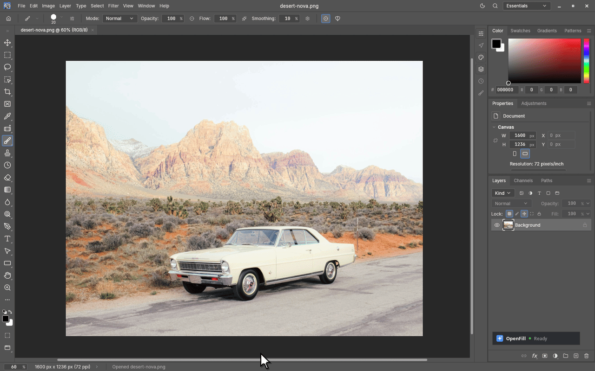

# OpenFill

     

*Generative fill, expand and object removal for PhotoCraft and GIMP 3, running on your graphics card. You own the whole pipeline, nothing leaves your computer.*

 
**Remove objects, fill a selection from a prompt, and expand the canvas, right inside your editor.** 

> [!IMPORTANT]
> **Beta.** OpenFill for PhotoCraft is at 0.2.2 and the GIMP plug-in is at 2.0.0-beta.6, both now with support for AMD graphics cards. Both work end to end on Windows with an 8 GB NVIDIA laptop GPU, which is what I build and test on, and on Linux. AMD cards are not tested yet, as I don't have one. The GIMP plug-in also runs on macOS. Most of the rough edges are in what the models draw, not in the plug-in; [Status](#status) lists them.

## Why I made this

I moved to GIMP 3 as my Photoshop replacement after paying Adobe an outrageously expensive cancellation fee. GIMP turned out to be a great alternative, but Adobe's AI image editing tools had become part of my workflow and I wasn't ready to give them up, so I made OpenFill. It now runs in PhotoCraft too. It's meant to feel familiar and easy to use, especially if you're coming from Photoshop. The selection is the mask, the result is a layer you can paint on or delete, and the AI backend (ComfyUI) starts hidden, stays warm while you work, and shuts down when the editor closes. No terminal, no browser tab, no second app to babysit.

Here's what you get:

<table>
<tr><td><b>Fill with a prompt</b></td><td>Select, type "a red door with brass handles", Enter. The fill lands on a new layer with a soft mask.</td></tr>
<tr><td><b>Remove object</b></td><td>Select, press Remove. No prompt. It erases the selection at your image's own resolution.</td></tr>
<tr><td><b>Generative Expand</b></td><td>Drag the canvas edges outward or pick a ratio, and it paints the new border. The prompt is optional.</td></tr>
<tr><td><b>Create</b></td><td>A new image or a new layer from a prompt, sized to the selection if there is one.</td></tr>
</table>

Results always go on new layers, in one undo step, so your existing layers are never painted over. In PhotoCraft it's a panel next to your image (and `Filter > Plug-ins > OpenFill`); in GIMP it's under `Filters > OpenFill`.

## Nothing leaves your computer

Generation runs in ComfyUI on your machine, listening on `127.0.0.1` only. The network comes into it only when you search for models or press Download (a model, or ComfyUI itself). Every file is checked against its size and SHA-256. No accounts, no telemetry, nothing that phones home. Details in [docs/security.md](docs/security.md).

## Install

You need an NVIDIA graphics card or an AMD Radeon RX 7000 or newer (8 GB for the best models; Remove and SD 1.5 run on less) and Windows 10/11 or Linux. On Windows, OpenFill can download ComfyUI for you, including ComfyUI's version for AMD cards. AMD support is new and untested on a real AMD card, see [AMD graphics cards](docs/install.md#amd-graphics-cards).

The model manager in the steps below is where you get models: in PhotoCraft it's the gear icon in the OpenFill panel, Models section (the **Open model manager** button on the first run goes there too); in GIMP it's `Filters > OpenFill > Generative Fill...`, Models tab.

**PhotoCraft (0.12 to 0.16)**

1. Install PhotoCraft, and Python from [python.org](https://www.python.org/downloads/) if you don't have it.
2. Download `openfill-photocraft-0.2.2.zip` from the [Releases page](https://github.com/beckettharriman/openfill/releases), unzip it and run **Install OpenFill for PhotoCraft.cmd** (Linux: `sh install.sh`).
3. Open **PhotoCraft with OpenFill**. The first time, the panel offers **Download ComfyUI** on Windows (or **Choose folder** if you have it) and then **Open model manager** to get LaMa (0.2 GB) and DreamShaper 8 Inpainting (2 GB).

More in [photocraft/README.md](photocraft/README.md).

**GIMP 3.2**

1. Download `openfill-2.0.0-beta.6.zip` from the [Releases page](https://github.com/beckettharriman/openfill/releases), unzip it, and run `Install OpenFill.cmd` (or drag the `gimp-openfill` folder into GIMP's plug-ins folder; macOS and Linux: `sh install.sh`).
2. Restart GIMP and run `Filters > OpenFill > Generative Fill...`. If ComfyUI isn't found, **Download ComfyUI** sets it up (Windows), or **I already have ComfyUI** lets you pick one.
3. Get LaMa and DreamShaper 8 Inpainting when the model manager opens. The first request starts the backend in about a minute; after that it's seconds.

<b>macOS, Linux, manual install and script options</b>

See [docs/install.md](docs/install.md).

## Models

OpenFill doesn't ship a model. The model manager only recommends models that fit your graphics memory and disk, and also finds your own SD 1.5 inpainting, SDXL and FLUX.1 Fill files (`.safetensors` and `.gguf`) in ComfyUI's folders.

| Job | Default model | Graphics memory | Time (RTX 4070 Laptop) |
|---|---|---|---|
| Remove object | LaMa (RORem and a FLUX eraser to compare) | 2 GB | about 5 s |
| Fast fill | DreamShaper 8 Inpainting | 4 GB | about 9 s |
| Quality fill | RealVisXL V5 with the Fooocus inpaint patch | 8 GB | 20 to 45 s |

Each model has its own license. MAT and the FLUX.1 Fill models are **non-commercial**. Details in [docs/models.md](docs/models.md).

## Status

Where it still falls short:

- **FLUX and Qwen fills, Expand and Create work at about 1024 px** and are scaled up, so on big images they come back softer. Remove is not affected.
- **SD 1.5 often ignores the prompt** on flat areas and small selections. Pick an SDXL model.
- **FLUX on 8 GB is slow.**

Changes are in [CHANGELOG.md](CHANGELOG.md) and [photocraft/CHANGELOG.md](photocraft/CHANGELOG.md). Bug reports are welcome on [Issues](https://github.com/beckettharriman/openfill/issues).

## Where it came from

OpenFill started as a GIMP 3 port of [Torben Giesselmann's GIMP plug-in](https://github.com/thndrbrrr/gimp-stable-boy). The backend is [ComfyUI](https://github.com/comfyanonymous/ComfyUI). Acly's [comfyui-inpaint-nodes](https://github.com/Acly/comfyui-inpaint-nodes) do the inpainting, and his [krita-ai-diffusion](https://github.com/Acly/krita-ai-diffusion) was the reference for how to build the graphs and manage the server. OpenFill is not affiliated with PhotoCraft.

Open, as in open source and on your own machine. Fill, as in the thing everyone else rents you by the month.

## License

[Apache-2.0](LICENSE) © 2026 Beckett Harriman.
